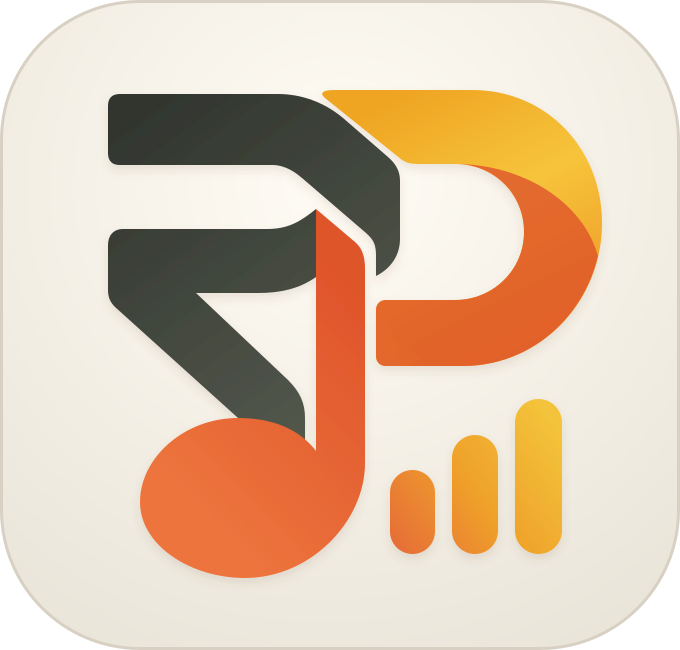

# YunPlex

<picture>
  <source media="(prefers-color-scheme: dark)" srcset="public/favicon.svg">
  
</picture>

**把网易云收藏带进你的 Plex 音乐库。**

YunPlex 是一个自托管的音乐同步工具，适合已经使用 Plex、希望把网易云歌单和专辑保存在 NAS 或本地的用户。添加收藏后，它会按设置下载缺少的音乐、写入标签和封面，并维护 Plex 歌单的成员与顺序；已有的 Plex 音乐也可以确认后直接复用。

收藏管理、首次接管、下载进度和异常处理都在网页中完成，适合在 NAS 上持续运行。

> 当前版本为 `2.0.9`，版本记录见[更新日志](CHANGELOG.md)。

## 主要功能

| 能力           | 可以做什么                                                                                            |
| -------------- | ----------------------------------------------------------------------------------------------------- |
| 管理网易云收藏 | 批量添加账号中创建或收藏的歌单、收藏的专辑，也可手动输入资源 ID；每份收藏可单独调整同步与下载设置。   |
| 同步 Plex 歌单 | 手动或定时核对成员与顺序，下载缺少的歌曲；支持完整检查和外部变动提示。                                |
| 复用已有音乐   | 歌单首次接管时查看 Plex 候选、采用自动安排或逐首确认；后续可以更换匹配，或改为下载独立副本。          |
| 整理下载文件   | 选择音质、目录与文件命名，写入歌曲标签和封面，保存原文、翻译与罗马音歌词。                            |
| 临时添加音乐   | 从单曲、歌单或专辑链接下载文件，适合临时补充音乐，不必先建立持续同步的收藏。                          |
| 跟踪进度与异常 | 在活动页查看下载、Plex 扫描和歌单更新结果，集中重试或忽略失败项；系统状态页提供连接、资源和日志信息。 |

首次接管的自动安排会标明选择来源，匹配分数表示元数据的接近程度，需要时可以人工调整。同步中的移除操作只影响 Plex 歌单条目，音乐文件会保留；重新下载时，新文件校验通过后才替换原文件。

## 运行前准备

- **网易云账号**：准备有效的网易云 Cookie，用于读取收藏和获取音源。可下载的歌曲与音质受账号权限和音源可用性限制，目前支持保存完整的 MP3、FLAC 音源。
- **Plex 音乐库**：准备服务器地址、Token 和音乐库名称。需要 Plex Media Server `1.41.9` 或更新版本，应用使用[官方 API 1.0](https://developer.plex.tv/pms/)。
- **共享音乐目录**：YunPlex 需要读写音乐目录，Plex 需要能读取同一批文件。分别运行在容器或不同主机时，先配置共享卷、SMB 或 NFS。

「Plex 路径前缀」只换算两端的文件路径。例如，同一份音乐在 YunPlex 中是 `/mnt/nas`，在 Plex 中是 `/music`，下载目录填前者、Plex 对应目录填后者；实际文件共享仍由挂载提供。

## 快速开始

### Docker Compose 源码构建

公开源码是整理后的 2.0.9 快照，Git 提交与正式镜像的构建提交不同。要安装已验收的镜像，请使用下方的 [GHCR 安装步骤](#使用-ghcr-镜像)。

需要 Git、Docker 和 Docker Compose：

```bash
git clone https://github.com/awillheartwu/yunplex2.git
cd yunplex2
mkdir -p data
```

编辑 [docker-compose.yml](docker-compose.yml)，将 `/your/nas/music:/mnt/nas` 的左侧替换为实际音乐目录。默认以 UID/GID `1000:1000` 运行，可通过 `YUNPLEX2_UID`、`YUNPLEX2_GID` 调整；启动前确保该身份能读写 `data/` 和音乐目录。

```bash
docker compose up -d --build
```

打开 `http://主机地址:3210`，按页面向导完成初始化。容器内的下载目录默认为 `/mnt/nas`。

### 使用 GHCR 镜像

正式镜像由 [GHCR 镜像包](https://github.com/users/awillheartwu/packages/container/package/yunplex) 分发，仅提供 `linux/amd64`；其他架构需从源码自行构建。下方示例使用固定版本 `2.0.9`。

下载 [deploy/ghcr.compose.yml](deploy/ghcr.compose.yml)，将以下内容保存为同目录的 `.env`：

```dotenv
YUNPLEX_IMAGE=ghcr.io/awillheartwu/yunplex:2.0.9
YUNPLEX_DATA_DIR=/path/to/yunplex/data
YUNPLEX_MUSIC_DIR=/path/to/music
YUNPLEX_UID=1000
YUNPLEX_GID=1000
YUNPLEX_PORT=3210
```

要锁定 `2.0.9` 的镜像内容，可将 `YUNPLEX_IMAGE` 设为 `ghcr.io/awillheartwu/yunplex@sha256:c66da21e3e6e80e0c091327c0286c451e9ac716cf2011fea1323c56b6e60ec15`。

填写两个本机绝对目录，先创建专用数据目录，确认音乐目录已存在，并让配置的 UID/GID 可以读写这两个目录，再执行：

```bash
docker compose -f ghcr.compose.yml pull
docker compose -f ghcr.compose.yml up -d
```

打开 `http://主机地址:3210` 完成初始化。更新时先备份数据，再将 `YUNPLEX_IMAGE` 改为目标固定版本或 digest，执行同样的 pull/up 命令。

### 本地运行

需要 Node.js 24 和 pnpm 10.33.0，版本分别由 [.nvmrc](.nvmrc) 和 [package.json](package.json) 指定。在源码目录执行：

```bash
pnpm install --frozen-lockfile
pnpm dev
```

开发页面为 `http://localhost:3001`。需要生产运行时：

```bash
pnpm build
pnpm start
```

生产服务默认使用 `3000` 端口，可通过 `NITRO_HOST`、`NITRO_PORT` 调整监听地址和端口。

## 第一次使用

1. **完成初始化**：设置管理员密码，验证网易云、Plex 和下载目录。
2. **添加收藏**：在「音乐库」添加网易云歌单或专辑，确认这份收藏的同步和下载设置。
3. **确认已有音乐**：歌单启用首次接管时，可以先审批歌曲安排，也可以选择自动处理；不合适的候选可改选、改为下载或暂缓。
4. **查看同步结果**：在「活动」跟踪下载、扫描和歌单更新，确认 Plex 中的歌曲与顺序；失败项可进入异常处理。

初始全局自动同步关闭，歌单默认最多同步 10 首。建议先确认完整流程，再按需将全局或单份歌单的数量上限改为 `0`（不限），并开启自动同步。临时下载使用「添加音乐」，它只负责保存文件，不直接修改 Plex 歌单。

## 数据与使用边界

- **同步方向**：网易云来源决定目标内容，YunPlex 据此更新本地音乐与 Plex 歌单。Plex 中的编辑不会回写网易云；检测到外部变动时会在收藏详情提示。
- **媒体复用**：日常同步通过唯一准确路径的托管文件或已确认关联复用音乐；未确认的外部文件不会被悄悄接管或覆盖。无法确认时，可下载独立副本或等待人工处理。
- **失败恢复**：临时错误按退避间隔恢复，达到快速重试次数后延长冷却；登录和目录问题暂停，版权、音源或身份问题等待人工处理。只有用户选择才会忽略；重试保留原任务设置，历史运行清理不影响恢复。详细规则见[失败与重试](docs/sync-flow.md#失败与重试)。
- **数据持久化**：账号凭据、配置和同步记录保存在数据目录的 `data.db` 中；默认是源码下的 `data/`，Docker 映射到 `/app/data`。音乐保存在另行配置的下载目录，两者都应备份；应用数据备份包含凭据，应妥善保存。
- **实例隔离**：每个实例使用独立数据目录，同一 Plex 歌单只由一个实例管理。

## 文档与反馈

更多说明见[文档索引](docs/README.md)：

- [同步与下载](docs/sync-flow.md)：同步模式、文件处理与失败恢复。
- [首次接管与匹配设置](docs/initialization-matching.md)：已有 Plex 音乐的选择、自动安排与纠错。
- [运维手册](docs/operations.md)：配置、部署、升级、备份与恢复。
- [待办](ROADMAP.md)：尚未完成的验收和后续功能。

参与开发请先阅读 [AGENTS.md](AGENTS.md)；模块入口见[代码结构](docs/architecture.md)，验证方式见[测试说明](tests/README.md)。项目使用 Nuxt 4、Nitro 和 SQLite，单个应用进程即可运行。

问题与建议可提交到 [Issues](https://github.com/awillheartwu/yunplex2/issues)。反馈时附上应用版本、现象与复现步骤；日志和截图请先隐去 Cookie、Token 等凭据。

## 许可证

YunPlex 自有代码采用 [MIT](LICENSE)，公开署名为 **YunPlex contributors**。第三方组件及内置字体保留原许可，见[第三方声明](THIRD_PARTY_NOTICES.md)。
