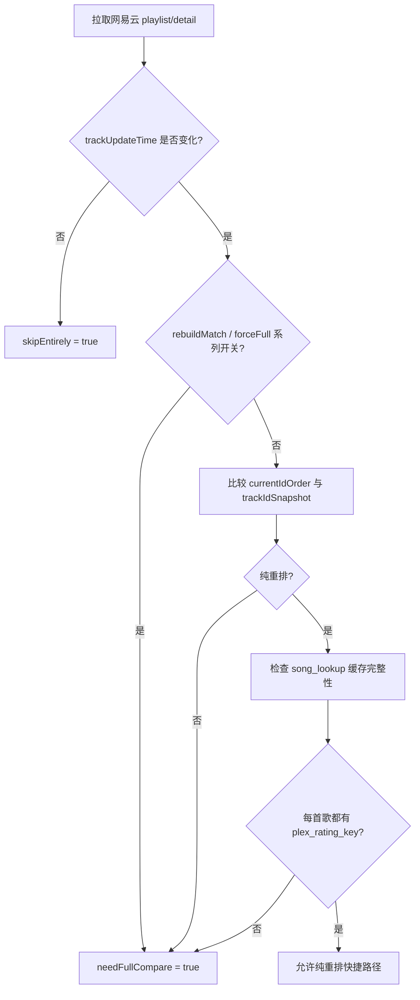

# 对比决策说明

这份文档只描述“是否跳过 / 是否走纯重排 / 是否进入 full compare”的判定规则。

## 唯一触发源

当前实现中，是否需要对一个 source 执行同步，只由网易云侧决定：

- 看 `trackUpdateTime`
- 不看 Plex 侧 `updatedAt`

这意味着：

- 即使 Plex 歌单被手工修改，只要网易云没变化，本轮仍可跳过
- Plex 中“多余歌曲是否保留”先由 `skipRemoveExtraTracks` 总开关控制；允许清理时，再由 `extraTrackRemovalPolicy` 决定严格保护、连续观察或立即精确对齐

## 决策链

## 规则展开

### 1. 直接跳过

满足以下条件时直接跳过：

- 不是专辑源
- `trackUpdateTime` 与 `lastTrackUpdateTime` 相同
- 没有 `forceFull`
- 没有 rebuild 模式
- 不是 dry-run
- 没有因为跳过次数或时间间隔触发自动全量

效果：

- 不进入 compare
- `consecutiveSkips + 1`
- 更新 `lastSyncedAt`

### 2. 纯重排快捷路径

满足以下条件时允许直接重排：

- 网易云发生变化
- 差异类型是“纯重排”
- 没有 rebuild 模式
- 没有 forceFull
- 当前 source 本次参与同步的每首歌，都能从 `song_lookup` 取到 `plex_rating_key`

否则即使是纯重排，也要回退 full compare。

### 3. full compare

以下任意情况都进入 full compare：

- rebuild 模式
- `forceFull`
- source / global `forceFullCompare`
- 自动全量触发
- 纯新增
- 纯删除
- 新增 + 删除 + 重排的混合变化
- 纯重排但缓存不完整
- 首次同步 / 没有 `trackIdSnapshot`
- 专辑源

## rebuild 模式

“重建匹配并同步”会在 compare 前做一件额外事情：

- 删除当前 source 本次 songIds 对应的 `song_lookup`

随后这次运行会：

- 强制 full compare
- 禁用纯重排捷径
- 正常更新 `trackIdSnapshot`、`lastFullCompareAt`、`lastTrackUpdateTime`

## 多余歌单项清理

清理只移除 Plex 歌单 occurrence，不会删除 Plex 音乐库中的媒体文件。无论选择哪种策略，待审核候选、目标身份不完整、空目标未经二次确认，以及插入或重排失败都会阻止删除。

- `strict`：只删除可追溯到既有全局身份、且对应网易云歌曲已经不在目标中的旧项；未知历史项持续保留。
- `balanced`（默认）：目标歌曲全部通过路径、MusicBrainz recording 或人工绑定验证后，对具有稳定 Plex 路径的未知旧项进行连续观察；第二个不同 run 仍存在时才授权删除。同一 run 重试不会重复计数，目标不完整或中途消失会重置连续次数。
- `exact`：目标歌曲全部建立强身份后，在本轮直接移除不属于目标顺序的多余 occurrence。

连续观察保存在 `playlist_extra_observations`，身份优先使用规范化 Plex 文件路径，`ratingKey` 仅作为无法取得路径时的诊断回退；平衡模式不会依赖回退键自动删除。

## 缓存完整性要求

纯重排不是“能排多少算多少”，而是“要么完整重排，要么回退 full compare”。

因此当前策略是：

- 缺任何一个 `plex_rating_key`，就认为缓存不完整
- 不允许生成残缺 `targetOrder`
- 必须回到 `DB -> Plex 搜索 -> 本地文件 -> 下载` 的完整链路

## 与文档旧版本的差异

旧设计里曾把 `plexChanged` 纳入跳过决策；当前实现已经明确取消这一点。

当前有效规则是：

- Plex 变化不触发同步
- Plex 只影响“同步时如何对齐”，不影响“这一轮要不要同步”
