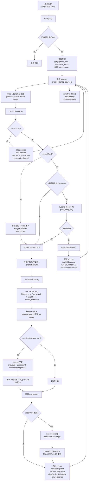
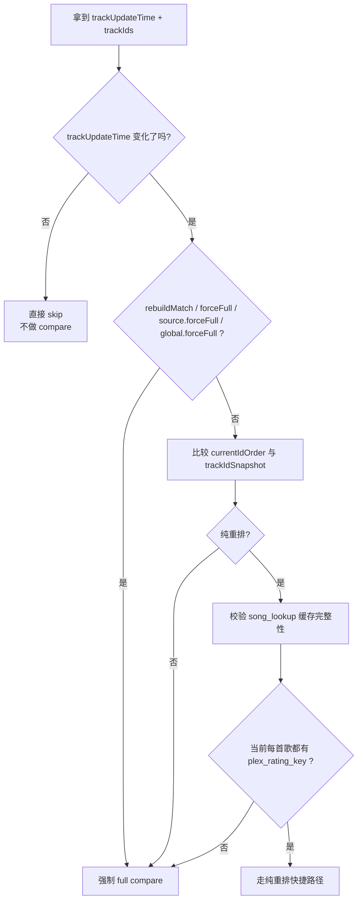

# 同步流程与缓存重建

本文档描述当前实际实现的同步主链路、对比决策、`song_lookup` 生命周期，以及 Docker 场景下的 Plex 路径替换规则。

## 核心原则

- 同步是否触发，只看网易云 `trackUpdateTime`
- Plex 只作为对齐目标，不参与“是否跳过同步”的判断
- 只有纯重排允许快捷路径
- 纯重排必须依赖完整可信的 `song_lookup.plex_rating_key`
- `song_lookup.file_path` 只保存 YunPlex 当前可访问的本地路径
- “重建匹配并同步”只清当前 source 本次同步范围内的 `song_lookup`

## 整体流程图

## 对比决策图

## `song_lookup` 与路径替换

### 字段语义

- `plex_rating_key`: Plex 库命中缓存
- `file_path`: YunPlex 当前可访问的本地路径缓存

### 路径映射规则

配置项：

- `download.dir`
- `download.plexLibraryPathPrefix`

当 Plex 返回媒体路径时：

1. 如果路径以 `plexLibraryPathPrefix` 开头
2. 则把这一段替换为 `download.dir`
3. 映射结果存在时，再写入 `song_lookup.file_path`

例子：

- `download.dir = /app/downloads/music`
- `plexLibraryPathPrefix = /music`
- Plex 返回 `/music/Jay/Album/01.mp3`
- 映射后保存 `/app/downloads/music/Jay/Album/01.mp3`

### 自愈规则

- `plex_rating_key` 无效：整条 `song_lookup` 删除
- `file_path` 映射后不存在：只清空 `file_path`
- `plex_rating_key` 仍有效时，不因为坏路径而丢掉 Plex 命中缓存

## 重建匹配并同步

“重建匹配并同步”是 source 级高级操作，不是新的任务类型。

行为：

1. 先拉当前 source 本次实际参与同步的网易云歌曲列表
2. 遵守 `syncLimit`
3. 删除这些 `songId` 对应的 `song_lookup`
4. 标记 rebuild 模式
5. 强制 full compare
6. 不清 `ignoredFailureIds`
7. 不清 `copyrightRestrictedIds`
8. 不清 `artist_resolution_cache`
9. 收尾时与正常 full compare 一样更新 `trackIdSnapshot`、`lastFullCompareAt`、`lastTrackUpdateTime`

## MusicBrainz 的定位

当前 MusicBrainz 只参与 artist alias 增强，不参与 title alias 生成。

候选优先级：

1. 原名
2. 手工 alias
3. MusicBrainz alias
4. 简繁转换

因此：

- `刘柏辛 -> Lexie Liu` 这类 artist 变体可由 MB 或手工 alias 处理
- 简繁 artist 变体可由脚本转换处理
- “标题被 Plex 刮成罗马音”不依赖 MusicBrainz，仍由标题规范化和保守匹配策略兜底
