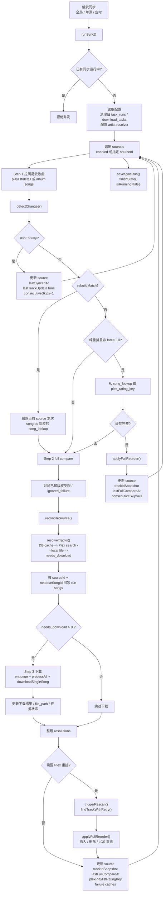
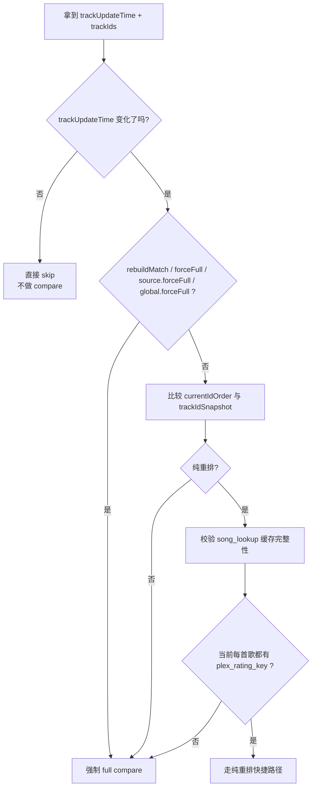

# 同步流程与缓存重建

本文档描述当前实际实现的同步主链路、身份绑定、`song_lookup` 生命周期，以及 Docker 场景下的 Plex 路径替换规则。

## 核心原则

- 同步是否触发，只看网易云 `trackUpdateTime`
- Plex 只作为对齐目标，不参与“是否跳过同步”的判断
- 只有纯重排允许快捷路径
- 纯重排必须依赖完整可信的 Plex `ratingKey`
- `song_lookup` 只是可丢弃的查询缓存，不决定歌曲身份或删除资格
- `song_identity_bindings` 保存全局歌曲身份；`local_media_assets` 保存本地文件来源与完整性
- 人工绑定优先于自动判断
- YunPlex 实际写入的托管文件，以映射后的唯一精确 Plex 路径作为最高自动身份证据
- 未经 YunPlex 写入的外部文件，即使计算路径相同，也只能作为候选，继续接受 MB、来源身份和高置信元数据校验
- “重建匹配并同步”只清当前 source 本次同步范围内的 `song_lookup`

## 整体流程图

## 对比决策图

## 本地媒体身份、`song_lookup` 与路径替换

### 字段语义

- `local_media_assets.file_path`: YunPlex 当前可访问的规范化本地路径
- `local_media_assets.ownership`:
  - `managed`: 音频字节由 YunPlex 下载并写入；精确路径可作为强身份
  - `external`: YunPlex 只发现或复用了已有文件；路径只是候选定位
- `local_media_assets.provenance`: `download_task`、`legacy_download_task`、`computed` 或 `manual`
- `local_media_assets.status`: `active`、`missing` 或 `replaced`
- `song_identity_bindings`: 可审计、可验证的全局身份
- `song_lookup`: `ratingKey` 与文件路径的性能缓存，删除后可重建

### 路径映射规则

配置项：

- `download.dir`
- `download.plexLibraryPathPrefix`

这两个根路径描述同一份文件在 YunPlex 与 Plex 运行环境中的不同名称，可用于双向换算。例如，当 Plex 返回媒体路径时：

1. 如果路径以 `plexLibraryPathPrefix` 开头
2. 则把这一段替换为 `download.dir`
3. 映射结果存在时，再写入 `song_lookup.file_path`

例子：

- `download.dir = /app/downloads/music`
- `plexLibraryPathPrefix = /music`
- Plex 返回 `/music/Jay/Album/01.mp3`
- 映射后保存 `/app/downloads/music/Jay/Album/01.mp3`

路径映射不执行上传、复制或目录同步。如果 Plex 位于另一台主机，`download.dir` 必须是 Plex 音乐库的共享挂载，或者需要由独立、可观测的发布流程把文件复制到 Plex 的 `Location`。只有字符串换算成功，不能证明 Plex 已经能读取该文件。

### 身份优先级

1. 有效的人工全局绑定
2. `managed + active` 本地资产映射后的唯一 Plex 精确路径
3. 已验证的自动全局绑定
4. 网易云来源提供方身份
5. 相同 MusicBrainz recording
6. 可配置的高置信元数据
7. 待审核候选

托管路径命中后不比较 Plex 的标题、艺人或专辑。Plex 刮削结果可以由用户自由修正，不会导致 YunPlex 在下一次同步中把同一文件当作另一首歌。

“精确路径”必须同时满足：

- 本地资产是 YunPlex 实际写入的 `managed` 文件
- 文件仍为普通文件，且大小和修改时间与写入后记录一致
- 路径经 `download.dir ↔ plexLibraryPathPrefix` 映射后完全一致
- Plex 中只有一个 `ratingKey` 声明该媒体路径

若一个路径对应多个 Plex 身份，或者托管文件在 YunPlex 外部被覆盖，系统撤销路径信任、进入审核并保持删除保护。

### 自愈规则

- `plex_rating_key` 无效：整条 `song_lookup` 删除
- `file_path` 映射后不存在：只清空 `file_path`
- `plex_rating_key` 仍有效时，不因为坏路径而丢掉 Plex 命中缓存
- 绑定的 `ratingKey` 变化但路径仍唯一存在：按路径恢复新的 `ratingKey`
- 托管文件缺失：标记 `missing`，等待下载或人工处理
- 托管文件大小或修改时间变化：标记 `replaced`，不再自动信任该路径
- 外部文件路径命中：保留为候选，不能单独触发自动绑定或删除

## 重建匹配并同步

“重建匹配并同步”是 source 级高级操作，不是新的任务类型。

行为：

1. 先拉当前 source 本次实际参与同步的网易云歌曲列表
2. 遵守 `syncLimit`
3. 删除这些 `songId` 对应的 `song_lookup`
4. 标记 rebuild 模式
5. 强制 full compare
6. 不清 `ignoredFailureIds`
7. 不清 `copyrightRestrictedIds`
8. 不清 `artist_resolution_cache`
9. 收尾时与正常 full compare 一样更新 `trackIdSnapshot`、`lastFullCompareAt`、`lastTrackUpdateTime`

## 重新下载全部音频并同步

“重新下载全部音频并同步”是用户显式触发的 source 级维护操作，与“全量同步”和“重建匹配”互相独立：

1. 只处理该歌单当前 `syncLimit` 范围内的唯一网易云歌曲 ID，同一首歌在歌单中重复出现时只下载一次
2. `managed` 文件会使用 `replace` 下载模式；新音频先写入临时文件，完成媒体格式校验和写标后才原子替换旧文件
3. 单曲下载、校验或写标失败时保留旧文件、旧全局绑定和旧 Plex 歌单项，并将本轮标为部分失败
4. 本轮绕过下载失败记忆重新请求，但不删除失败历史
5. `external` 文件默认受保护；只有确认弹窗中显式选择“接管并替换外部文件”后才允许覆盖，并在成功后转为 `managed`
6. 人工全局绑定始终受保护，即使选择接管外部文件也不会被自动覆盖
7. 成功下载后请求 Plex 扫描；路径变化时重新按精确路径寻找并更新身份，路径不变时保留稳定身份
8. 目标身份未完整收敛、Plex 校验失败或下载失败时继续启用删除保护

该操作不会清空 `song_lookup`、MusicBrainz 缓存或歌曲身份绑定。它解决音频载荷需要整体更新的问题，不负责纠正人工或 Plex 元数据决定。

## MusicBrainz 的定位

MusicBrainz 同时参与 artist alias 增强和歧义歌曲的 recording 身份确认。它不生成通用 title alias；只有原始 recording 查询完全为空时，才会针对 `feat.` / `ft.` / `featuring` / `with` 合作艺人描述执行受控标题降级。例如 `Vanish (feat. KARRA)` 可降级为 `Vanish`，但 `Live`、`Remix`、`Demo` 等录音版本描述不会被移除。

当多个 recording 的 MusicBrainz 相关度分数不足以区分时，同步器会使用网易云/Plex 提供的时长做第二层消歧：

1. 先排除 `Instrumental`、`Live`、`Remix`、`Demo` 等与目标版本描述不兼容的候选
2. 所有分数相近的竞争候选都必须提供 MusicBrainz 时长
3. 最近候选与目标的差值不得超过 `sync.metadataDurationToleranceSec`（默认 2 秒）
4. 最近候选必须唯一，且相对第二近候选至少领先 500 ms

四项都通过才可将 recording 作为自动绑定的强身份证据。缺少时长、并列最近、领先不足或超出误差都会继续进入审核。目标时长、每个候选的 MusicBrainz 时长、差值、版本兼容性和选择结果都会写入缓存及匹配证据。带时长的缓存键按目标时长和策略隔离，避免同名不同版本互相污染。

候选优先级：

1. 原名
2. 手工 alias
3. MusicBrainz alias
4. 简繁转换

因此：

- `刘柏辛 -> Lexie Liu` 这类 artist 变体可由 MB 或手工 alias 处理
- 简繁 artist 变体可由脚本转换处理
- “标题被 Plex 刮成罗马音”不依赖 MusicBrainz，仍由标题规范化和保守匹配策略兜底

## MusicBrainz 身份类型

Plex 的 `mbid://<uuid>` 是未标注实体类型的外部 GUID，不能直接视为 MusicBrainz recording ID；它也可能是 release-track ID。同步器只直接信任明确带有 `recording` 命名空间的 GUID。generic MBID 会按需向 MusicBrainz 验证：先检查 recording 实体，再通过 `tid:` 将 release-track 映射到 recording，并将类型化结果持久缓存。

## Plex 来源提供方身份

当 Plex 曲目携带可识别的网易云提供方 GUID（例如 `com.plexapp.agents.WangYiYun://artistId/albumId/disc/track`）时，同步器会把它作为类型化来源证据，而不是普通字符串元数据。只有以下条件全部成立才自动绑定：

1. GUID 中的艺人 ID 属于网易云歌曲的艺人 ID 集合
2. 专辑 ID 与音轨号精确一致；GUID 提供有效碟号时碟号也必须一致
3. 标题身份一致，不能跨越 `Live`、`Remix` 等版本差异
4. Plex 与网易云时长差不超过配置的元数据时长阈值

该证据优先于 MusicBrainz 查询，可处理 `陈奕迅` / `Eason Chan` 这类 Plex 展示名称变化。任一来源字段缺失、冲突或 GUID 无法识别时仍进入审核，不会退化成只看标题的自动绑定。

托管路径身份仍优先于所有外部元数据。精确路径失败后允许进行一次大小写折叠查找，但只有折叠结果唯一对应一个 Plex 路径和 `ratingKey` 时才能自动绑定；大小写敏感文件系统中的冲突路径会继续保留审核。外部文件即使路径唯一，也必须继续通过来源身份、MusicBrainz、高置信元数据或人工审核确认。

只有全部 generic ID 成功且唯一地映射到同一个 recording 时，才可作为自动绑定证据。网络失败、空结果、多候选或冲突映射均进入审核并维持删除保护。

## 高置信元数据绑定

`sync.enableHighConfidenceMetadataBinding` 默认关闭。启用后，仅当目标和候选都没有可用或冲突的 MusicBrainz recording 时，才评估以下全部字段：

1. 去除合作艺人括号后的标题一致，且 `Live` / `Remix` 等身份描述兼容
2. 完整艺人集合数量一致并能一一对应；多艺人歌曲缺少完整 Plex credit 时失败
3. 专辑名经 Unicode、简繁和标点规范化后一致
4. 音轨号存在且相同
5. 时长存在，差值不超过 `sync.metadataDurationToleranceSec`（默认 2 秒）

五项全部通过才建立 `metadata` 全局绑定。任一字段缺失、不一致，或两侧 MB recording 冲突，都会继续进入审核并保持删除保护。证据逐字段写入绑定和审核记录，便于在 run 与匹配审核页追溯。
